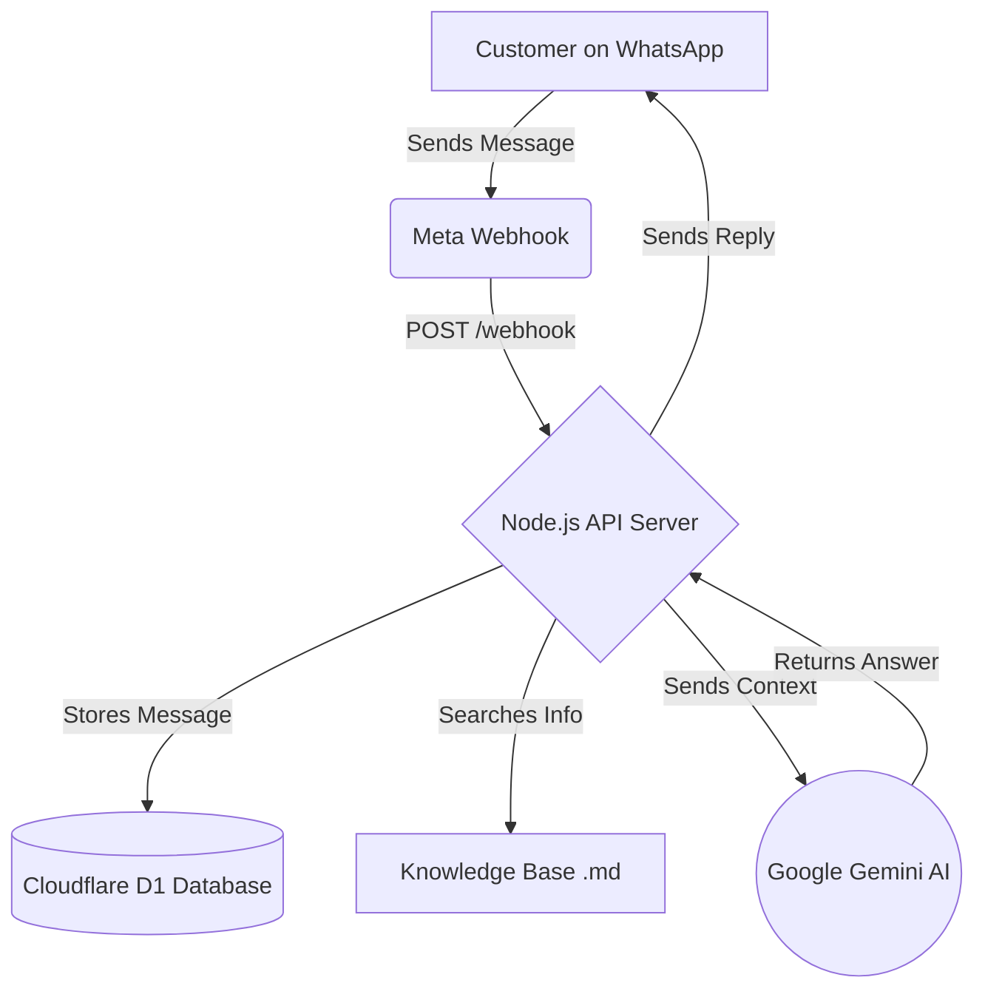

# 🔮 Astrology AI WhatsApp Chatbot

A production-ready WhatsApp AI Chatbot backend using Meta's WhatsApp Cloud API, Google Gemini AI, and Cloudflare D1.

**Made by Krishan** 
⭐ *If you find this project helpful, please give it a star!*

## 📖 Overview

This project allows you to seamlessly integrate Google's powerful **Gemini AI** into WhatsApp. It receives messages from customers, understands the context, searches a predefined Markdown Knowledge Base for accurate business details, and replies instantly on WhatsApp.

It is highly optimized, fully built with TypeScript, uses Hono (a very fast web framework), and stores conversation history in a serverless database (Cloudflare D1).

---

## 🛠️ Features

- **WhatsApp Cloud API Integration:** Official and reliable way to connect.
- **Gemini AI (1.5 Flash):** Fast, highly intelligent AI that answers questions naturally.
- **Serverless Database (Cloudflare D1):** Maintains conversation history context and rate limits users without heavy server costs.
- **Multi-language Support:** Automatically detects Hindi, English, and Marathi, and replies in the user's preferred language.
- **Markdown Knowledge Base:** Easy to update business facts, pricing, or details via simple Markdown `.md` files.

---

## 📂 Folder Structure

```text
📦 astrologyaibackend
 ┣ 📂 apps
 ┃ ┣ 📂 api               # Main Node.js/Hono API server (Handles Webhooks & AI)
 ┃ ┗ 📂 d1-api            # Cloudflare Worker for Database (D1) access
 ┣ 📂 knowledge           # Add your business details here in .md files
 ┣ 📜 DEPLOYMENT.md       # Detailed guide on deploying to Render & Cloudflare
 ┗ 📜 package.json        # Monorepo setup
```

---

## 🔄 Flowchart: How it Works



---

## 🚀 How to Setup & Use

### 1. Prerequisites
- A Google Gemini API Key.
- Meta Developer Account (WhatsApp Cloud API setup).
- Cloudflare Account (for the free D1 database).

### 2. Configure Environment Variables
Inside the `apps/api` folder, create a `.env` file and add your keys:
```env
# ── Google Gemini AI ──
GEMINI_API_KEY=your_gemini_api_key

# ── Meta WhatsApp Cloud API ──
WHATSAPP_ACCESS_TOKEN=your_whatsapp_token
WHATSAPP_VERIFY_TOKEN=your_custom_verify_token
# ... (check .env.example for all fields)
```

### 3. Start Locally
To run the server locally for testing:
```bash
# Install dependencies
npm install

# Start the API server
npm run dev:api
```

### 4. Deploy
Please check the `DEPLOYMENT.md` file for step-by-step instructions on deploying the server to Render and setting up the database on Cloudflare!

---

*Made with ❤️ by Krishan*
